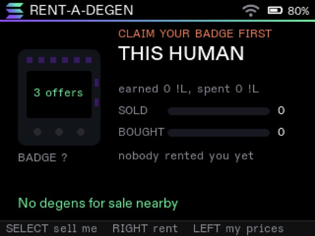
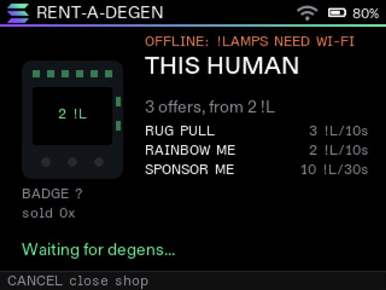
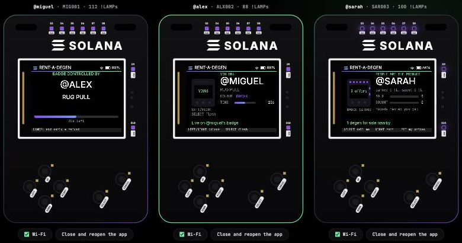
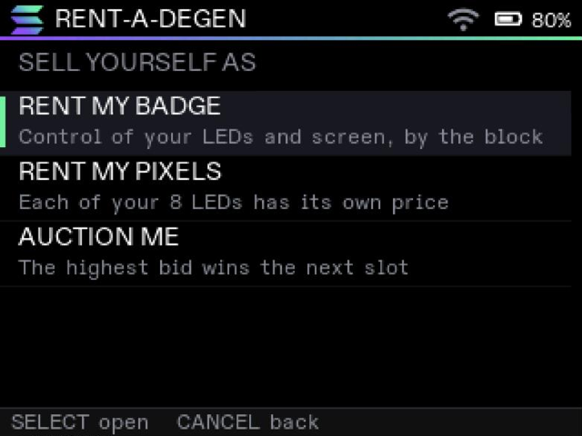
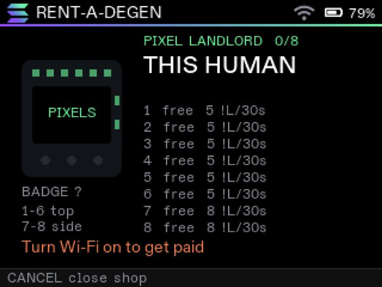
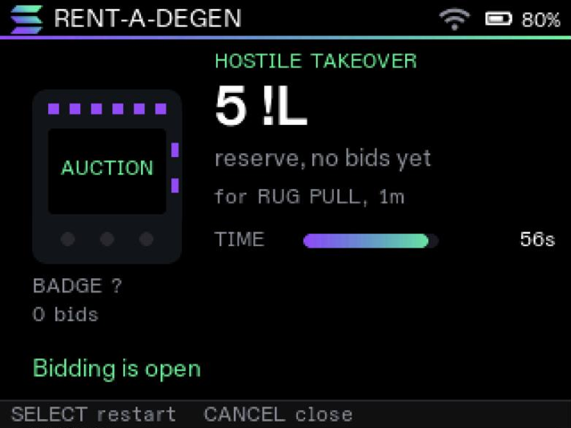
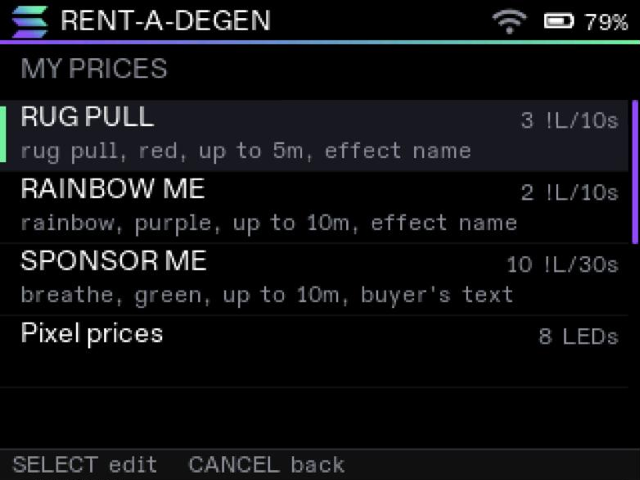
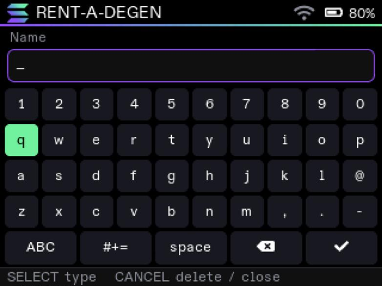

# RENT-A-DEGEN

**Sell timed control of your Solana BP26 badge for !LAMPs, at your own prices. Rent it by the block, rent out
each of its LEDs, or auction the next slot to whoever bids the most.**

By [MrNameless10](https://github.com/MrNameless10). A Lua 5.5 app for the Breakpoint 2026 badge, 24 files, 54 KB,
built to run inside the badge's 48 KB of Lua heap.

<p align="center">
  
  
</p>

<p align="center">
  <a href="#try-it">Try it</a> ·
  <a href="#how-to-use">How to use</a> ·
  <a href="#screens">Screens</a> ·
  <a href="#how-it-works">How it works</a> ·
  <a href="PROTOCOL.md">Protocol</a> ·
  <a href="#simulator-and-tests">Simulator and tests</a>
</p>

## What it is

Your badge is the product. Open a shop in one of three modes, set every price yourself, and the people around
you pay in !LAMPs to take over your lights and screen:

- **Rent my badge.** Offers sold by the block. Each offer has an effect, a colour, a block length (5 s to 5 min),
  a price per block and a maximum number of blocks (up to 60). The buyer picks how long they want. An offer can
  let the buyer put their own text on your screen, and you can approve it first.
- **Rent my pixels (Pixel Landlord).** Each of the 8 LEDs has its own price. Several buyers rent different LEDs at
  the same time and each picks a colour. With all 8 rented, the badge reads `100% COMMUNITY-OWNED`.
- **Auction me (Hostile Takeover).** The next slot goes to the highest bid, with a reserve price, a minimum raise
  and anti-sniping: a bid in the last 10 s extends the auction. If the winner doesn't pay, the slot passes to the
  next bidder.

Everything runs over the badge mesh. Payments use the OS payment dialog and are checked by balance. No servers, no
accounts, no wallet.

## Try it

### In the official emulator

The app installs through the console of the real firmware, compiled to WebAssembly.

1. Open <https://solana.com/breakpoint/badge/emulator> in a desktop browser.
2. Open the browser console (<kbd>⌥</kbd><kbd>⌘</kbd><kbd>J</kbd> on a Mac, <kbd>Ctrl</kbd><kbd>Shift</kbd><kbd>J</kbd>
   elsewhere), paste the contents of [`emulator/paste.js`](emulator/paste.js) and press Enter.

```bash
pbcopy < emulator/paste.js
```

To see two badges talk, open a second tab of the emulator next to the first. !LAMPs only move between claimed
badges: join a demo Wi-Fi network on each and claim them with different accounts.

### In the local emulator, with payments

```bash
python3 emulator/serve.py
```

Open <http://localhost:8765/emulator/>. Three badges drawn like the real board run the real app in Lua
(WebAssembly) on the simulated OS in [`sim/`](sim), with mesh between them, a !LAMPs ledger, the OS payment
dialog, Wi-Fi on and off, and "close and reopen the app".

<p align="center">
  
</p>

### On your badge

Upload the [`rent-a-degen/`](rent-a-degen) folder on the badge app store. `app.json` fills in the form.

## How to use

| Key | Home | Shops |
|---|---|---|
| SELECT | open your shop | choose |
| RIGHT | shops nearby | change time, colour or bid |
| LEFT | my prices | change time, colour or bid |
| CANCEL | quit | back, close the shop, end a rental early with a refund |

Text is typed on the badge's on-screen keyboard: the arrows pick a key, SELECT types it, CANCEL deletes (or closes
the keyboard when it's empty) and ✓ confirms.

In **MY PRICES** you edit the offers, the pixel prices, the auction, whether buyers' texts need your approval, and
you can reset everything to the examples. **+ Add an offer** is at the end of the list, up to 6 offers.

## Screens

All taken from the official emulator, running the real firmware.

<p align="center">
  
  
</p>
<p align="center">
  
  
</p>
<p align="center">
  
</p>

## How it works

```
rent-a-degen/        the app (this is the folder you publish)
  main.lua           OS callbacks → the active screen
  lib/core.lua       state, screen switching, validation, UI helpers
  lib/fx.lua         LED engine: 7 effects and the pixel grid
  lib/net.lua        mesh queue on a ring buffer, under 4 messages/s
  lib/counter.lua    the seller's till: adverts, payment checks, sales
  lib/home.lua       you as the product: earnings, spending, who rented you
  lib/open.lua       pick the shop mode
  lib/sell.lua       offer shop
  lib/owned.lua      your badge while it's rented
  lib/pixels.lua     Pixel Landlord
  lib/auction.lua    auction
  lib/buy.lua        shops nearby
  lib/menu.lua       a shop's menu
  lib/pixbuy.lua     a shop's LEDs
  lib/bid.lua        bidding room
  lib/pick.lua       time and colour picker
  lib/rent.lua       order and payment
  lib/control.lua    live control
  lib/edit.lua       your prices
  lib/form.lua       data-driven form engine
  lib/defaults.lua   example prices
  lib/owe.lua        pending refunds
  lib/refund.lua     offer pending refunds at launch
emulator/            three-badge local emulator and the installer for the official one
sim/                 simulated Solana OS and tests
tools/               heap measurement
docs/screens/        screenshots
PROTOCOL.md          mesh messages, and why payments can be checked
```

### Memory

The badge gives an app 48 KB of Lua heap. A store build runs its code from flash. In development (the emulator,
"Run on badge") the badge compiles the source and the compiled code lives in the heap. That is the hard case, and
the app is designed around it:

- **One screen at a time.** `core.go` switches screens on the next tick, once the old screen is off the stack, so
  it is garbage before the new one compiles. Screens pass data through `core.ctx`.
- **Small screens.** Each screen loads only what it uses. Seller screens share one till (`counter.lua`) through a
  metatable.
- **No allocation per frame.** Effects use integer arithmetic on packed colours (`led.hex`), the mesh queue reuses
  a fixed ring buffer, and LED changes are mirrored to the on-screen badge only when they change.
- **Seamless animation.** The effect clock wraps at 8 064 000 ms, the least common multiple of every effect period,
  so no animation jumps.
- **Cheap labels.** `ui.label` calls go through a positional helper (`core.text`). That saves a table constructor
  per call and cuts about 23 % of the compile peak.
- **32-bit safe.** The badge runs Lua with 32-bit numbers, so durations are kept in seconds, never milliseconds ×
  price.

Live Lua heap measured on the real firmware (official emulator, compiled on the badge, cap 49 152 bytes):

| Screen | Bytes |
|---|---|
| home | 32 128 |
| sell | 42 490 |
| pixels | 43 668 |
| auction | 43 273 |
| owned | 45 571 |
| buy + menu + picker | 42 973 |
| pixbuy + picker | 40 843 |
| bid | 40 935 |
| rent | 39 401 |
| control | 41 813 |
| edit | 42 274 |

`sh tools/heap.sh` measures the compile peak and live heap of every screen locally with an instrumented allocator
(64-bit Lua 5.5; the badge uses about 0.7× of that).

### Payments

There is no backend. The buyer pays through the OS dialog (`lamps.transfer`) and the seller confirms by watching
its own balance go up by the exact amount, one checkout at a time. Every field that arrives over the mesh is
range-checked before use. If the seller quits during a rental, the refund owed is saved and offered the next time
the app starts. The full message list is in [PROTOCOL.md](PROTOCOL.md).

## Simulator and tests

```bash
lua sim/test.lua
```

67 checks across three simulated badges: buying by the block, approved text, ending early with a refund, a fake
payment, 18 malformed messages, a cancelled payment, quitting mid-rental with a refund, the price editor, Pixel
Landlord with queued orders and 8/8 LEDs, and an auction with anti-sniping and the slot passing to the next bidder.

The simulator enforces the badge's limits: 200 bytes and 4 messages/s on the mesh, 64 UI objects, 16 KB of
storage, 200 000 instructions per callback and 500 !LAMPs a day.

After changing the app, rebuild the installer and the local emulator's file list:

```bash
python3 emulator/bundle.py
```

## Known limits

- Payments have no backend: one checkout at a time per seller. Refunds for a seller who quits mid-rental are
  offered at the next launch, but can't be forced.
- The 500 !LAMPs daily limit comes from the OS.
- While an app with mesh runs, Wi-Fi only stays up on the mesh channel. The app detects when it's offline and
  says so.

## License

[MIT](LICENSE)
